# Spark Server Go Architecture

This document explains how the source tree fits together and follows the main runtime flows through the system. It is intended as the starting point for contributors who need to change behavior rather than only operate the server.

See [`README.md`](README.md) for setup and commands, [`COMPATIBILITY.md`](COMPATIBILITY.md) for route coverage, and [`examples/Products.md`](examples/Products.md) for product and firmware requests.

## Quick flow index

| Flow | Section |
| --- | --- |
| Startup / shutdown | [Application composition and lifecycle](#application-composition-and-lifecycle) |
| OAuth password grant | [HTTP API, authentication, and ownership](#http-api-authentication-and-ownership) |
| Device TCP handshake | [Encrypted device connection](#encrypted-device-connection) |
| Session loop dispatch | [Encrypted device connection](#encrypted-device-connection) |
| Live variable / function / ping | [Live REST-to-device commands](#live-rest-to-device-commands) |
| Description + automatic firmware check | [Device descriptions and automatic firmware checks](#device-descriptions-and-automatic-firmware-checks) |
| Event fan-out (SSE + webhooks) | [Event, SSE, and webhook flow](#event-sse-and-webhook-flow) |
| Provisioning / claim | [Claiming and provisioning devices](#claiming-and-provisioning-devices) |
| Firmware upload + OTA | [Firmware metadata and OTA](#firmware-metadata-and-ota) |
| Storage | [Persistence model](#persistence-model) |
| Wire protocol stack | [Wire protocol, layer by layer](#wire-protocol-layer-by-layer) |
| Operator CLI | [`sparkctl`](#sparkctl) |

## System purpose

Spark Server Go is a Go port of the Brewskey `spark-server` local cloud for TCP-capable Particle/Spark devices. It uses the Go standard library for both listeners and for storage.

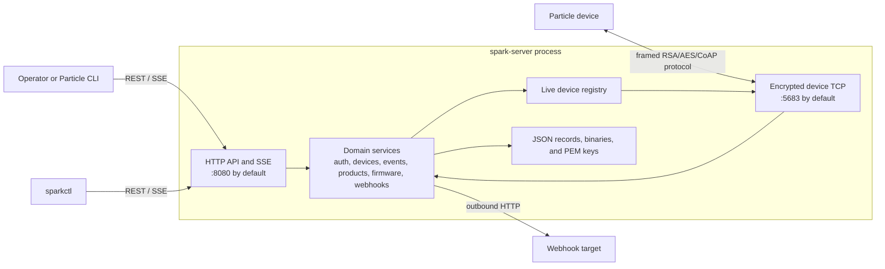

Three design decisions:

- **Zero third-party dependencies.** Routing, TLS, crypto, CoAP, and JSON storage all come from the Go standard library. `go.mod` is module `sparkserver` on Go 1.27 with no external requires.
- **Layered ownership.** Each feature package owns its models and its repository *interfaces*; `internal/jsonfile` is the only concrete persistence implementation. Swapping in another backend later means new repository implementations, not service changes.
- **Cycles broken by interfaces.** `devices`, `events`, and `firmware` never import `protocol/tcp`. They program against small interfaces: `LiveDeviceClient`, `FlashTransport`, `DeviceFirmwareUpdater`, and `events.Sink`. `internal/app` satisfies them by injecting the TCP server.

The server starts with two listeners:

- The HTTP listener serves the Particle-compatible REST API and server-sent events (SSE). It defaults to port `8080` and supports HTTPS.
- The TCP listener defaults to port `5683`. Devices use it to publish events, answer variable and function requests, and receive over-the-air (OTA) firmware.

Both listeners share service instances created by `app.New`. The TCP server sends device-originated packets through `protocol/device.Handler` and uses the live registry to find the client for each outgoing command.

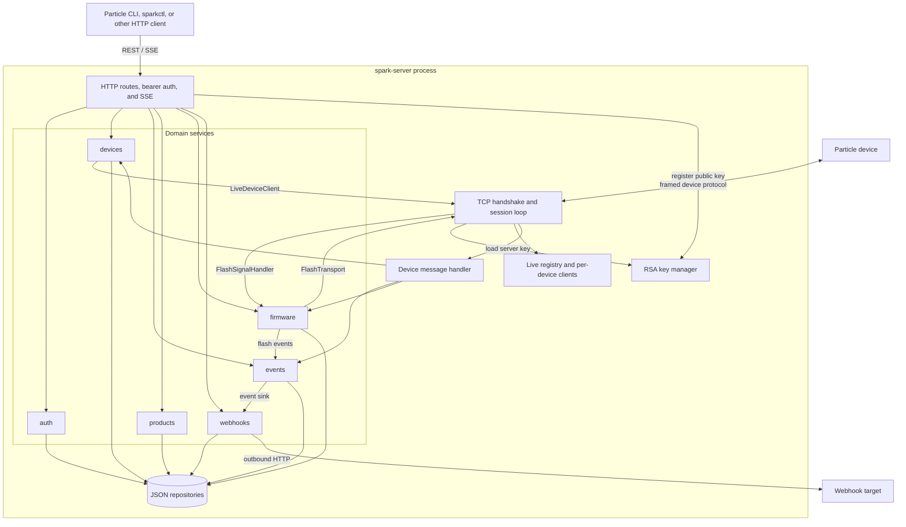

## Directory map

Generated `bin/`, `dist/`, and runtime `data/` directories may exist in a working copy, but they are not part of the maintained source tree.

| Path | Responsibility | Key types |
| --- | --- | --- |
| `cmd/spark-server/` | Minimal server executable: logging, configuration loading, signal cancellation, startup, waiting, and bounded shutdown. | `main()`: load config, build app, run, graceful shutdown |
| `cmd/sparkctl/` | Minimal operator CLI executable. Delegates argument parsing and HTTP behavior to `internal/monitorcli`. | `main()` → `monitorcli.Run` |
| `internal/app/` | Composition root. Creates repositories and services, connects HTTP and TCP dependencies, and owns the two listener lifecycles. | `Server`: `New`, `Start`, `Wait`, `Shutdown` |
| `internal/auth/` | Users, salted password hashes, password-grant login, bearer tokens, expiry checks, and the default administrator. | `Service` (`Login`, `CreateUser`, `AuthenticateToken`), `User`, `AccessToken` |
| `internal/config/` | Legacy `settings.json` decoding, defaults, listener addresses, TLS fields, timeouts, and runtime directory creation. | `Config`, `Load`, `Default`, `EnsureDirectories` |
| `internal/devices/` | Claiming/provisioning, ownership, device metadata, connection state, descriptions, and REST-to-TCP live commands. | `Service` (`Claim`, `Provision`, `GetVariable`, `CallFunction`, `Ping`, `MarkConnected`) |
| `internal/events/` | Event persistence, filtered in-process subscriptions, SSE fan-out, and dispatch to event sinks. | `Service` (`Publish`, `Subscribe`, `AddSink`), `Filter`, `Sink` |
| `internal/firmware/` | Prebuilt binary metadata, file storage and checksums, firmware selection, per-device targeting, OTA manifests, and flash-job state. | `Service`: upload, selection, `StartDeviceFlash`, chunk pump, job state |
| `internal/httpapi/` | `net/http` server lifecycle, authentication middleware, REST handlers, SSE handlers, request decoding, and response compatibility. | `Server`, route registration, `requireAuth`, SSE writer |
| `internal/jsonfile/` | Private generic one-file-per-record store plus domain-specific repository adapters. | `store[T]` (generic), `New*Repository` adapters |
| `internal/monitorcli/` | `sparkctl` command parsing, automatic login, typed API client, output formatting, and SSE consumption. | `Run`, `Client` |
| `internal/netutil/` | Converts wildcard listener addresses into advertised local addresses for logs and tests. | `AdvertisedAddress` |
| `internal/products/` | Product/fleet CRUD, product-device membership, ownership checks, and desired firmware version policy. | `Service`: product CRUD, membership, firmware locks |
| `internal/protocol/coap/` | Encoding and decoding the Particle-flavored CoAP message subset. | `Parse`, `Marshal` |
| `internal/protocol/device/` | Dispatch of device-originated pings, descriptions, and events; schedules firmware checks after description ACKs. | `Handler` |
| `internal/protocol/framing/` | Bounded two-byte big-endian length-prefixed TCP frames. | `Reader` |
| `internal/protocol/handshake/` | Parses the first device frame and RSA-decrypts the symmetric session key. | `Handshaker` |
| `internal/protocol/keys/` | Server RSA key creation, PEM I/O, device public-key storage, and RSA helpers. | `Manager` |
| `internal/protocol/particle/` | Particle path and query aliases such as `v`, `f`, `d`, `e`, `u`, `c`, and `p`. | Path constants, option builders |
| `internal/protocol/session/` | Session identity and AES-128-CBC/HMAC-SHA1 authenticated message codec. | `Codec` |
| `internal/protocol/tcp/` | TCP accept loop, live registry, encrypted session loop, pending request correlation, live commands, and OTA transport. | `Server`, `Client`, `Registry` |
| `internal/webhooks/` | Webhook CRUD, matching, template expansion, outbound delivery, status recording, and exponential retry gating. | `Service`: CRUD, `DeliverEvent` sink, backoff |
| `test/collider/` | Reusable virtual-device identities and protocol behavior used by collider tests. | `NewIdentity`, `Device` |
| `test/` | Cross-package HTTP, TLS, protocol, lifecycle, and virtual-device end-to-end tests. | |
| `examples/` | Operator-oriented settings, product API, OTA, and real-hardware walkthroughs. | |
| `scripts/` | Cross-platform release archive builder. | |
| `.github/workflows/` | Continuous integration and release automation. | |
| `Makefile` | Local build, test, clean, and release entry points. | |
| `COMPATIBILITY.md` | Supported, limited, deferred, and intentionally unsupported compatibility surface. | |
| `RELEASE.md` | Versioning and release procedure. | |

## Application composition and lifecycle

`cmd/spark-server/main.go` loads `settings.json` or uses defaults. `app.New` constructs the dependency graph without opening listeners. `Server.Start` creates directories and keys, ensures the admin user, and then opens HTTP followed by TCP. `Server.Wait` returns on cancellation or a terminal listener error. Shutdown closes active TCP connections and drains HTTP requests with the deadline created by `main`.

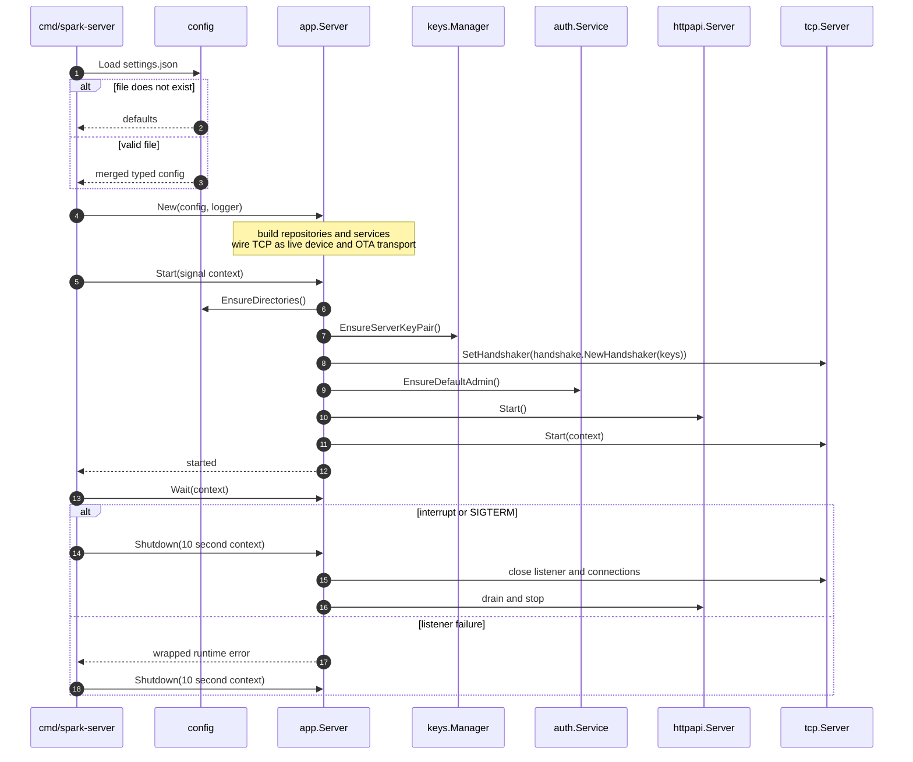

`app.New` in `internal/app/app.go` builds the object graph. It wires the cross-cutting bridges after both endpoints exist:

- `eventService.AddSink(webhookService)`. The events service fans out every published event to webhooks.
- `deviceService.SetLiveClient(tcpServer)`. The device service forwards REST calls such as `GET /v1/devices/{id}/{var}` to a live device over TCP.
- `firmwareService.SetFlashTransport(tcpServer)`. An OTA job pushes chunks to a live device.
- `tcpServer.SetFlashSignalHandler(firmwareService)`. Device-originated OTA signals (missed-chunk retry, abort) drive the firmware job state machine.
- `tcp.Server` sends device messages to `protocol/device.Handler`.
- `protocol/device.Handler` persists descriptions through `devices.Service`, publishes through `events.Service`, and asks `firmware.Service` to check for automatic updates.
- HTTP handlers receive the same service instances, so both endpoints see the same state.

`Wait` selects on both listener error channels and the context, so a terminal failure of either listener, or an interrupt, ends the process. TCP `Shutdown` closes the listener, closes every tracked connection, and waits for the accept loop to drain; HTTP drains in-flight requests within the 10-second deadline. `netutil.AdvertisedAddress` rewrites a wildcard bind into a reachable local IPv4 (via a UDP dial probe) so startup logs show an address devices can reach.

## Configuration

`internal/config` mirrors the legacy Brewskey `settings.json` shape (`DEFAULT_ADMIN_USERNAME`, `*_DIRECTORY`, `EXPRESS_SERVER_CONFIG`, `TCP_DEVICE_SERVER_CONFIG`, `DB_CONFIG`, …). Every omitted field falls back to a default:

| Key | Default | Meaning |
| --- | --- | --- |
| `DEFAULT_ADMIN_USERNAME` / `DEFAULT_ADMIN_PASSWORD` | `__admin__` / `adminPassword` | First-run admin account |
| `DEVICE_DIRECTORY`, `EVENTS_DIRECTORY`, … | `data/…` | One directory per feature's JSON records |
| `SERVER_KEYS_DIRECTORY` | `data` | `default_key.pem`, `default_key.pub.pem`, `deviceKeys/` |
| `LOGIN_ROUTE` | `/oauth/token` | Password grant endpoint |
| `ACCESS_TOKEN_LIFETIME` | `7776000` (90 days) | Bearer token TTL, seconds |
| `API_TIMEOUT` | `30000` ms | Deadline for live device variable/function/ping calls |
| `EXPRESS_SERVER_CONFIG.PORT` | `8080` | REST/SSE port (`USE_SSL` + PEM paths for HTTPS) |
| `TCP_DEVICE_SERVER_CONFIG.PORT` | `5683` | Device protocol port |
| `DB_CONFIG.DB_TYPE` | `file` | Persistence backend (only `file` is implemented) |

Both listeners bind all interfaces by default.

## HTTP API, authentication, and ownership

`httpapi.NewHandler` builds a pattern-based `http.ServeMux`. Public routes include health, root metadata, login, user creation, ping, and the two provisioning variants. `requireAuth` wraps most `/v1` routes in bearer authentication.

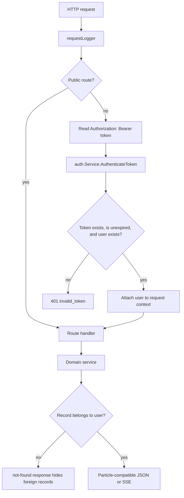

The login path is the Particle password grant:

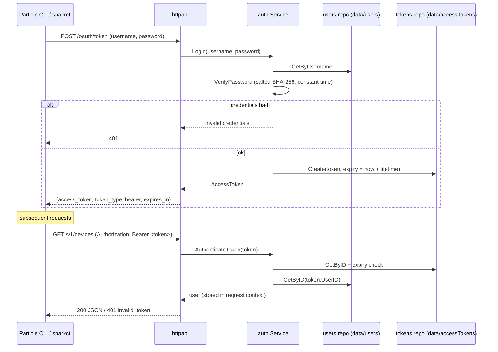

- `POST /oauth/token` accepts form credentials or HTTP Basic credentials.
- The auth service stores passwords as `sha256:<salt>:<hash>` with a 16-byte random salt and verifies them with constant-time comparison.
- A token is 32 random bytes, hex-encoded, stored as a JSON record with its user ID, scopes, and expiry (default 90 days).
- `requireAuth` wraps every protected route; handlers read the user from the request context.
- `POST /v1/users` registers accounts; `GET /v1/access_tokens` lists tokens and `DELETE /v1/access_tokens/{id}` revokes one.

Product, device, webhook, token-listing, and related service methods filter or validate by owner ID. A caller generally receives `not found` rather than learning that another owner's record exists.

## Claiming and provisioning devices

There are two compatible provisioning paths.

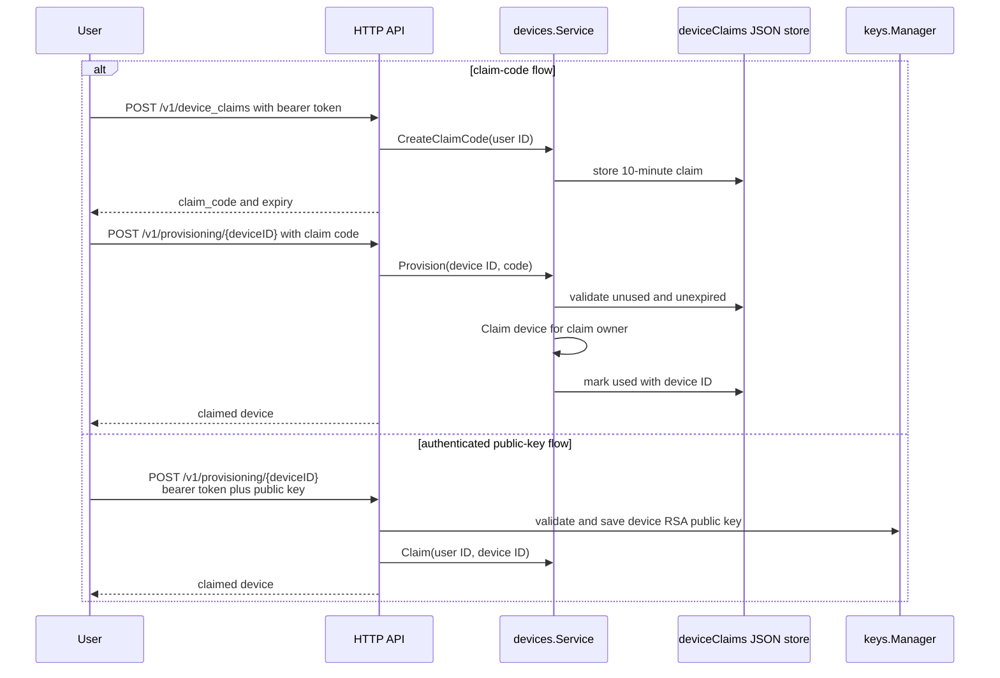

- Claim codes are 16 random bytes, hex-encoded, single-use, and expire after 10 minutes.
- The public-key path validates and stores the device RSA public key as `data/deviceKeys/<id>.pub.pem` before claiming.
- `POST /v1/devices` claims an already-known device ID directly; `PUT /v1/devices/{id}` renames; `DELETE` unclaims; a legacy `signal` acknowledgement route also exists.
- Claiming creates a placeholder device if no record exists. A later TCP connection or device description fills in connection state, variables, functions, attributes, and product metadata. A device that connects unclaimed still gets a record on first connection via `MarkConnected` / `UpdateDescription`.

## Encrypted device connection

The TCP protocol is layered so that framing, handshake, authenticated encryption, CoAP parsing, request correlation, and device-domain dispatch can be tested separately.

### Handshake

The handshake frame layout is:

```text
┌────────┬─────────────┬──────────────────────────────────────────┐
│ ver=1  │ devIDLen    │ deviceID ... │ sessKeyLen (2, big-end)   │
│ (1 B)  │ (1 B)       │ (devIDLen)   │ + encrypted session key   │
└────────┴─────────────┴──────────────────────────────────────────┘
```

The session key is a 16-byte symmetric key. The device generates it and encrypts it with the server's RSA public key (PKCS#1 v1.5); the device obtains that public key out of band, for example via `particle keys server`. The server decrypts it with its private key.

The server sets a 30-second deadline on each new connection. The first frame contains a version byte set to `1`, a one-byte device ID length, the device ID, a two-byte big-endian encrypted-key length, and the encrypted key. The device encrypts its 16-byte session key with the server's RSA public key. The server closes the connection if it cannot parse the hello or decrypt the key.

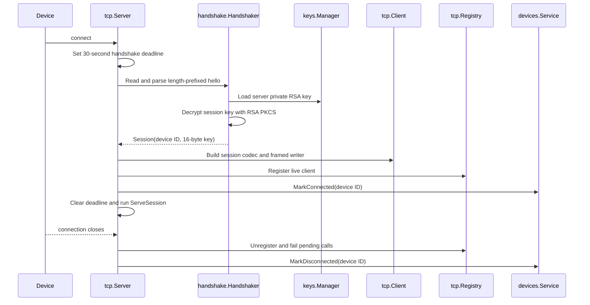

The handshake accepts the device ID in a valid hello without a device signature check. Provisioning stores device public keys as PEM files for compatibility.

After the handshake, session messages use:

- a two-byte big-endian frame length, bounded to 64 KiB while reading;
- a random AES initialization vector;
- AES-128-CBC ciphertext with PKCS#7 padding;
- an HMAC-SHA1 over the IV and ciphertext;
- a Particle-flavored CoAP packet as plaintext.

The session loop verifies the HMAC before decryption. Invalid framing, authentication, padding, or CoAP data terminates the device session.

Once handshaken, `ServeSession` runs a tight read → decrypt → parse → dispatch → respond loop for the life of the connection:

### Wire format and paths

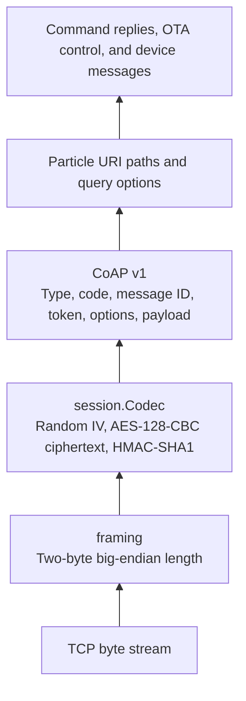

The two-byte length allows payloads up to 65,535 bytes per frame. The codec verifies HMAC-SHA1 over the IV and ciphertext before decrypting and removing PKCS#7 padding. The resulting plaintext is a CoAP packet.

| Operation | CoAP paths used by the implementation |
| --- | --- |
| Variable read | `GET variable/{name}` |
| Function call | `POST function/{name}` with an `arg` query option and the argument as the payload |
| Ping | The server sends `GET ping`. It also recognizes inbound `p` and `ping`. |
| Device description | `d`, `describe`, `description`, `hello`, `h`, `attributes`, or `attrs` |
| Device event publish | `e`, `event`, `events`, `publish`, or `spark` |
| OTA | `POST u` begins the update, `POST c` sends a chunk, and `PUT u` sends UpdateDone. Devices use `GET c` to report missing chunks. |

### Session loop

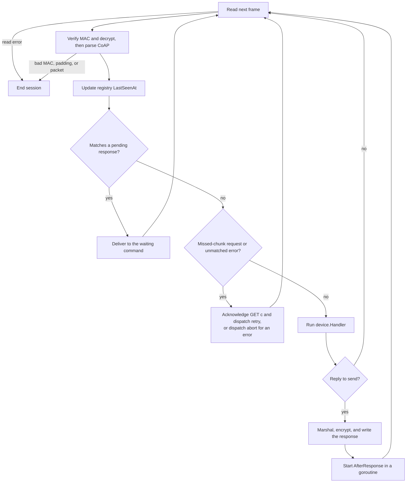

`tcp.Client` checks response packets against pending requests by message ID, then by token. Unmatched packets go through OTA control handling before reaching `device.Handler`. The device handler replies to pings, descriptions, and event publishes with `2.04 Changed`. It sends an empty ACK for other confirmable packets.

## Live REST-to-device commands

Variable reads, function calls, and pings cross from HTTP to the connected device and back through the pending-request map.

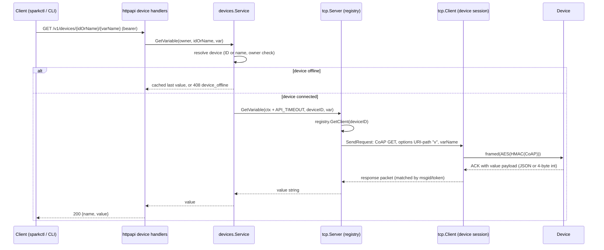

- Function calls (`POST /v1/devices/{id}/{function}`, `?arg=…`) and pings (`PUT /v1/devices/{id}/ping`) follow the same shape: CoAP `POST f/{fn}` with an `arg` query and argument payload, and CoAP `GET p` respectively.
- If no live client exists, the device is offline. A variable read may fall back to the last value stored in the device description; functions and pings require a live connection.
- The per-call deadline comes from `API_TIMEOUT`. A deadline maps to `ErrDeviceTimeout` (HTTP 408 `device_timeout`); a missing live client maps to `ErrDeviceOffline` (HTTP 408 `device_offline`).

## Device descriptions and automatic firmware checks

Devices publish description/hello packets using several Particle-compatible aliases. The handler accepts multiple historical JSON shapes for variables, functions, and attributes.

1. `protocol/device.Handler` parses the description.
2. `devices.Service.UpdateDescription` records advertised capabilities, marks the device connected, and derives `ProductID` from known attribute aliases.
3. The server sends the description ACK.
4. After the server writes the ACK, `AfterResponse` checks for a product firmware update in a goroutine. This ordering avoids starting OTA before the device has completed its describe exchange.
5. The firmware service honors a product-device `desired_firmware_version` when present; otherwise it selects the current/default product firmware.

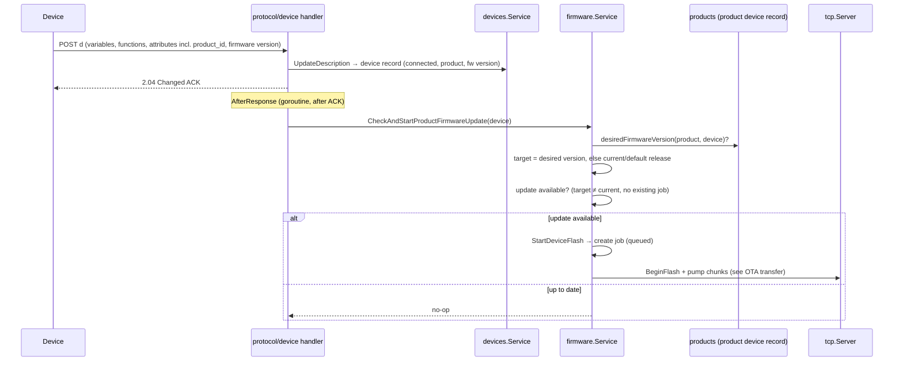

`GET /v1/products/{product}/firmware/check` exposes the same comparison for clients.

## Event, SSE, and webhook flow

Events may originate from an authenticated HTTP publish, a connected device packet, or the firmware service's `spark/flash/*` progress notifications.

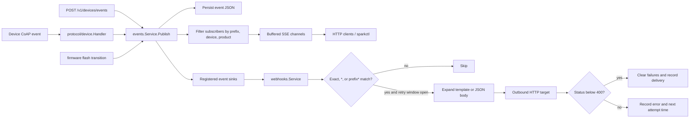

SSE:

- Routes: `GET /v1/events[/prefix]`, `GET /v1/devices/{id}/events[/prefix]`, `GET /v1/products/{p}/events[/prefix]`.
- Each subscription filters by name prefix, device, or product and owns a buffered channel of 16 events plus a cleanup goroutine that exits when the request context is canceled.
- Fan-out is non-blocking. If a subscriber cannot keep up, the service drops new events for that subscriber rather than blocking publication or other subscribers.
- The SSE writer flushes `event: <name>` / `data: {json}` frames per event. The HTTP server has no server-wide `WriteTimeout` because of these long-lived responses.

Webhook delivery:

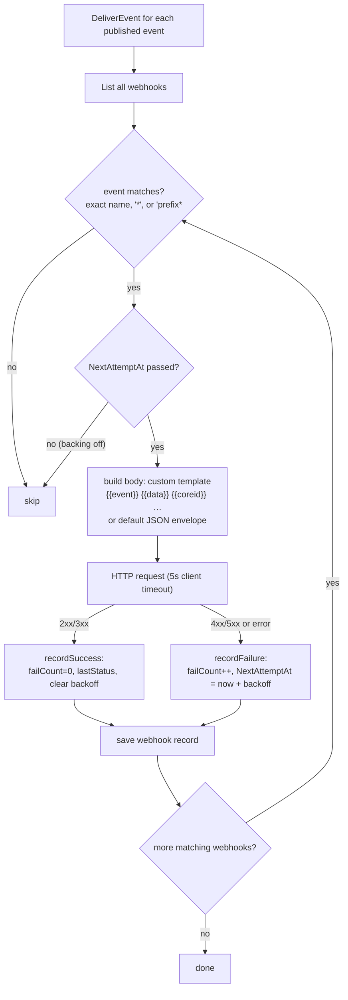

- Delivery is synchronous with the publishing call; the outbound client has a five-second timeout. `events.Service` ignores sink errors after the webhook service persists its own status.
- Failure backoff starts at one minute, doubles per consecutive failure, and caps at one hour. There is no background retry worker; the stored `NextAttemptAt` gates delivery when a later matching event arrives.
- Updating a webhook via `PUT` resets its failure counters.

## Firmware metadata and OTA

The server does not compile source firmware. An operator uploads a prebuilt binary (`POST /v1/products/{product}/firmware`, multipart `.bin`); the server stores it separately from its JSON metadata. Upload records the file size and SHA-256 checksum and auto-increments the version. The `release`, `default`, and `current` flags are mutually managed. Promoting one clears the others. An operator can then select firmware by ID or version and target it globally or per product device.

### Selection flow

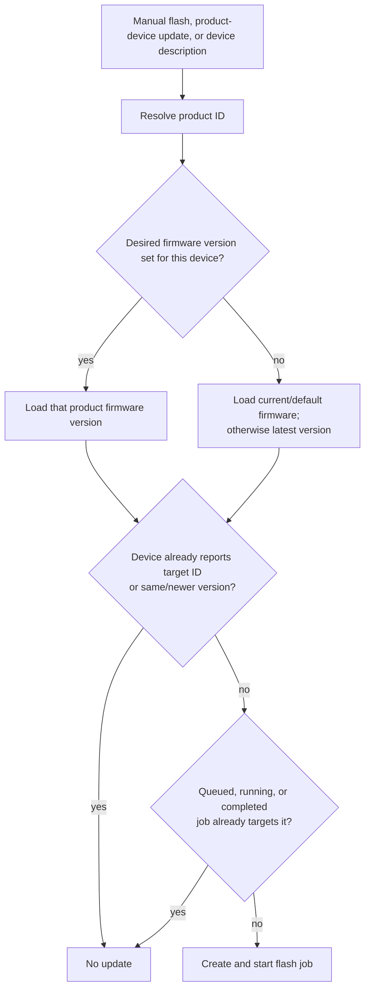

An explicit per-device desired version may select unreleased firmware. Automatic selection without a desired version requires the target to be released, current, or default.

### OTA transfer

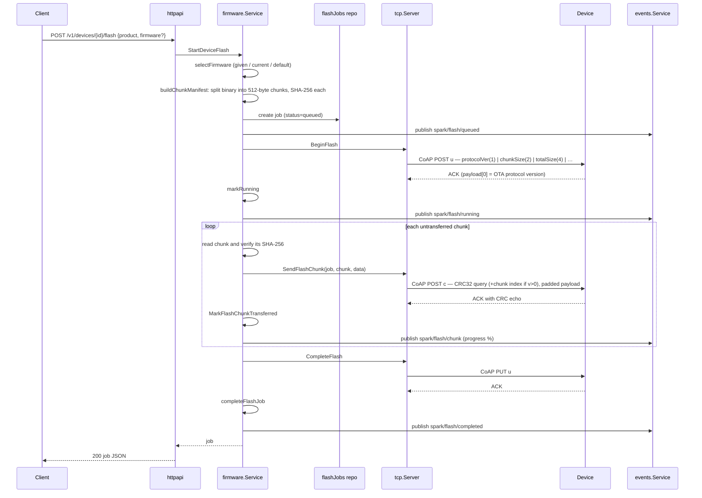

Job state machine:

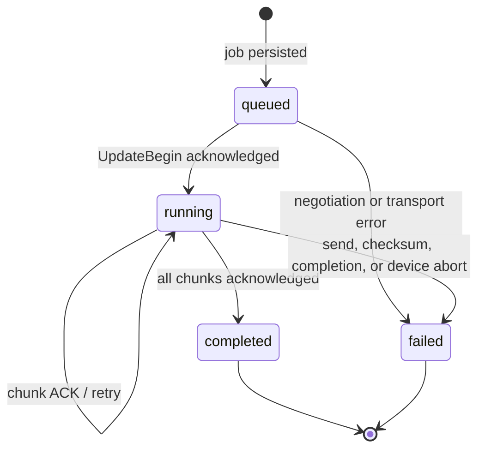

The `tcp.Client` absorbs device-originated OTA control during the session loop:

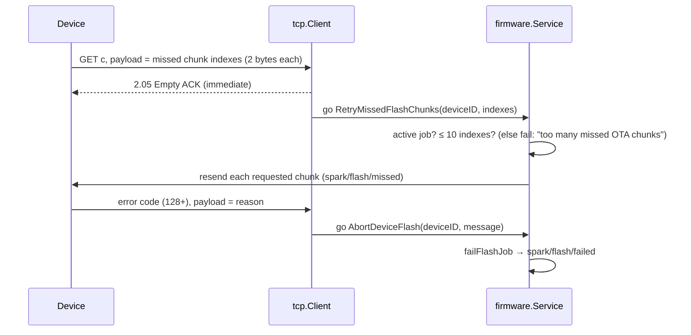

- A `GET c` packet acknowledges a missed-chunk request and resends up to ten valid requested chunk indexes.
- A device error response aborts the active job and records its message.
- Transport, checksum, or completion errors move the job to `failed` and publish `spark/flash/failed`.
- Clients poll `GET /v1/devices/{id}/flash` and `GET /v1/devices/{id}/flash/{jobID}` for job state. The server also publishes progress as `spark/flash/*` events over SSE and webhooks.

## Persistence model

The `jsonfile` package keeps its generic store private and exposes repositories that satisfy interfaces owned by the consuming domain packages. This lets services remain storage-agnostic while the current runtime stays file-backed.

The store writes each record as `<validated-id>.json`. It rejects IDs containing path separators, empty IDs, `.` and `..`. Writes use a temporary file in the target directory followed by rename, so readers do not see a partially encoded JSON document. An in-process read/write mutex protects each repository instance. The store sorts lists by filename for deterministic API and test behavior.

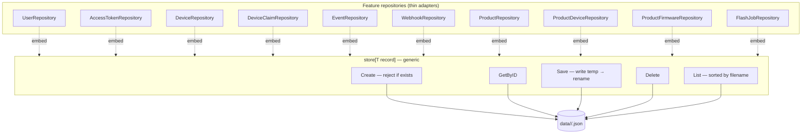

Default runtime layout:

```text
data/
├── users/            <userID>.json               username, salted hash, scopes
├── accessTokens/     <token>.json                user, scopes, expiry
├── devices/          <deviceID>.json             owner, product, connected, variables, functions, attributes
├── deviceClaims/     <code>.json                 owner, expiry, used-at
├── events/           <eventID>.json              name, data, device, product, timestamp
├── webhooks/         <webhookID>.json            event pattern, URL, method, headers, body, delivery status
├── products/         <productID>.json            slug, name, owner
│   └── devices/      <productID>_<deviceID>.json membership + desired_firmware_version
├── knownApps/
│   ├── metadata/     <firmwareID>.json           version, size, sha256, release/default/current flags
│   ├── binaries/     <firmwareID>.<extension>    uploaded firmware images
│   └── flashJobs/    <jobID>.json                chunk manifest, status, progress, error
├── default_key.pem / default_key.pub.pem         server RSA-2048 keypair
└── deviceKeys/       <deviceID>.pub.pem          device public keys from provisioning
```

The store is safe against partial writes inside one server process, but it is not a transactional database: multi-record operations can partially succeed, each process holds its own repository mutexes, and scans implement secondary lookups. The project implements only the file backend but keeps `DB_CONFIG` for compatibility.

## Wire protocol, layer by layer

From the socket up to the domain:

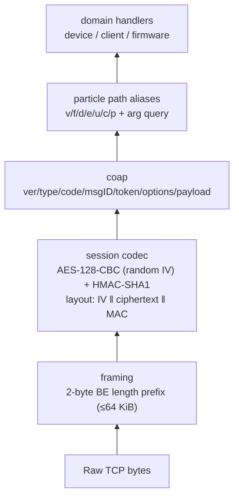

| Layer | Package | Responsibility |
| --- | --- | --- |
| Framing | `protocol/framing` | Length-prefixed frames; bounds allocation (`ErrFrameTooLarge`) |
| Session | `protocol/session` | AES-128-CBC encrypt/decrypt + HMAC-SHA1 auth; PKCS#7 padding; layout `IV ‖ ciphertext ‖ MAC` |
| CoAP | `protocol/coap` | CoAP v1 packet encode/decode, delta option encoding, tokens |
| Particle | `protocol/particle` | Path aliases + `OptionsForPath` / `OptionsForPathAndQuery` |
| Keys | `protocol/keys` | RSA-2048 keypair gen/load, per-device public keys, PEM I/O |
| Handshake | `protocol/handshake` | Hello frame → decrypted session |
| TCP | `protocol/tcp` | Listener, session loop, command client, registry |
| Device | `protocol/device` | Device-originated ping/describe/event dispatch |

Particle path aliases:

| Alias | Meaning | Used for |
| --- | --- | --- |
| `v` / `variable` | variable | live variable read |
| `f` / `function` | function | live function call (`?arg=`) |
| `d` / `describe` | description | device hello (vars/funcs/attrs) |
| `e` / `event` / `events` | event | device event publish |
| `u` / `start` | update | OTA begin / complete |
| `c` / `chunk` | chunk | OTA chunk / missed-chunk retry |
| `p` / `ping` | ping | keepalive |

## Product and fleet behavior

Products are owned records addressable by ID or normalized slug. A separate product-device record stores membership and policy fields: denied, development, quarantined, notes, and the desired firmware version.

Adding a product device requires an already claimed device owned by the same user. It creates the membership record and writes the product ID back to the device. Removing the membership clears that product ID when it still points to the same product. Deleting a product removes its membership records before removing the product record.

The server registers team and OAuth-client compatibility routes, but they return `501 not_supported`. See `COMPATIBILITY.md` for the exact supported route matrix.

## `sparkctl`

`cmd/sparkctl` installs signal cancellation and calls `monitorcli.Run`. The CLI uses the standard library `flag` package, not a framework. Global flags and environment variables provide the base URL and credentials.

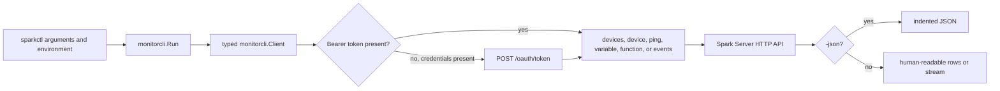

- Commands: `login`, `devices`, `device <id>`, `ping <id>`, `variable <id> <var>` (alias `var`), `function <id> <fn> [arg]` (alias `call`), `events [-device <id>]`.
- Flags: `-base`, `-token`, `-username`, `-password`, `-json`.
- Environment: `SPARK_SERVER_URL`, `SPARK_TOKEN`, `SPARK_USERNAME`, `SPARK_PASSWORD`.

`events` consumes SSE until cancellation. Other commands use a typed JSON request/response path. When no token is present but a username and password are, the CLI logs in first.

## Concurrency and failure boundaries

- The HTTP server runs one handler goroutine per request using `net/http`.
- The TCP accept loop starts one goroutine per connection and tracks all active sockets for shutdown.
- Each live TCP client serializes frame writes and protects pending request maps independently.
- Event subscriptions own a cleanup goroutine that exits when the request context is canceled.
- Firmware checks after device descriptions and device-originated OTA retry/abort work run asynchronously.
- Context cancellation flows through HTTP requests, live device calls, server lifetime, and shutdown. Disconnect persistence uses `context.WithoutCancel` so online state can still be cleared after the connection context ends.
- HTTP intentionally has no server-wide `WriteTimeout`, because SSE connections are long-lived. Read-header, request-read, and idle timeouts remain enabled.
- Webhook clients have a five-second timeout; live device calls use configurable `API_TIMEOUT`.

## Test map

Package-local tests verify configuration, storage, products, firmware, CLI behavior, listener utilities, framing, keys, handshake, session encryption, CoAP, and TCP lifecycle behavior.

The root `test/` suite verifies assembled behavior:

| Test area | What it covers |
| --- | --- |
| `app_test.go` | Full server start and shutdown. |
| `auth_http_test.go` | User creation, password login, tokens, and rejected credentials. |
| `device_http_test.go` | Device routes, auth, claims, provisioning, live calls, and timeouts. |
| `event_http_test.go`, `sse_recorder_test.go` | HTTP event publish, SSE delivery, filtering, and compatibility routing. |
| `product_http_test.go` | Product CRUD, membership, and limited compatibility routes. |
| `firmware_http_test.go` | Binary upload/update/delete, release/default selection, checks, flash jobs, and legacy upload. |
| `webhook_http_test.go` | CRUD, delivery, templating behavior, and retry gating. |
| `http_tls_test.go` | TLS startup and invalid TLS configuration. |
| `protocol_device_handler_test.go` | Device ingress, description aliases, live commands, encrypted session behavior, and OTA packets. |
| `tcp_registry_test.go` | Registry timestamps and persisted online/offline state. |
| `collider_*_test.go` | Virtual devices exercising encrypted connection, provisioning, live HTTP calls, webhooks, chaos, and reconstructed OTA binaries. |

The collider helpers are not a second server implementation. `NewIdentity` mints a device ID and RSA keypair, and `collider.Device` speaks the real framing/CoAP/codec stack over a TCP connection, so tests drive the real TCP and HTTP server paths together against a temporary data directory.

## Build and release flow

```mermaid
flowchart LR
    Source["Go source and docs"] --> Test["go test ./..."]
    Source --> Build["make build"]
    Build --> Bin["bin/spark-server and bin/sparkctl"]
    Source --> Release["make release"]
    Release --> Matrix["darwin, linux, windows<br/>amd64, arm64, and linux armv6"]
    Matrix --> Archives["dist/*.tar.gz"]
    Archives --> Checksums["dist/checksums.txt"]
    Test --> CI[".github/workflows/ci.yml"]
    Archives --> ReleaseCI[".github/workflows/release.yml"]
```

The Makefile builds both binaries with CGO disabled, `-trimpath`, and stripped symbols. Release archives also include the README, compatibility and release notes, and examples.


## Deliberate limits and extension points

- The project implements only file-backed persistence; MongoDB remains an extension point behind domain-owned store interfaces.
- Firmware must be compiled externally and uploaded as a prebuilt binary.
- The handler tree registers only the v1 compatibility routes; consult `COMPATIBILITY.md` before adding aliases.
- Product team and OAuth-client operations are compatibility stubs.
- Event subscription delivery is best-effort in memory, and the server does not replay persisted events into new SSE subscriptions.
- Webhook backoff is event-driven; there is no background retry scheduler.
- The server trusts the device ID from a successfully decrypted handshake. The current handshake does not use the stored device public key to authenticate a device signature.

When adding a feature, keep dependency direction consistent: define the smallest storage or transport interface in the domain package that consumes it, implement adapters in `jsonfile`, `httpapi`, or `protocol/tcp`, and connect concrete implementations only in `internal/app`.
